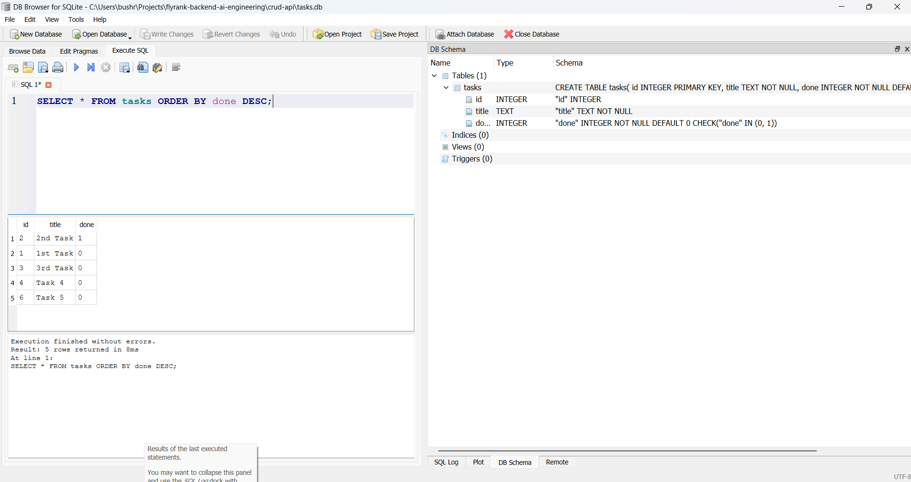
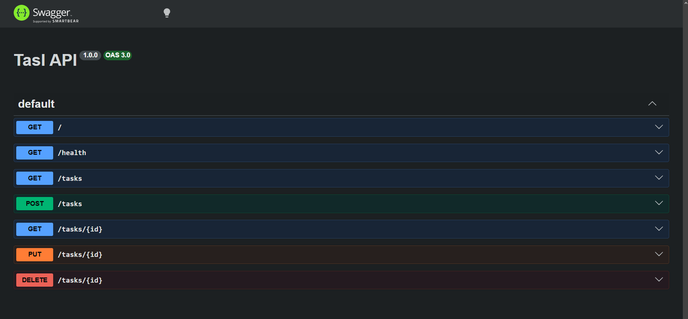

# Task API

A simple Express API for creating, reading, updating, and deleting tasks. Tasks are stored in SQLite and survive server restarts.

## Install and run

Requires Node.js 22 or newer and npm. From the **repository root** (the folder containing `package.json`), install dependencies and start the project with one command.

Command Prompt, PowerShell 7+, or Bash:

```sh
npm ci && npm start
```

Windows PowerShell 5.1:

```powershell
npm.cmd ci; if ($LASTEXITCODE -eq 0) { npm.cmd start }
```

On Windows, use `npm.cmd` in place of `npm` if PowerShell blocks `npm.ps1`.

The API runs at <http://localhost:3000>. Open <http://localhost:3000/docs/> for Swagger UI.

## Why SQLite?

SQLite keeps the database in a single file, needs no separate database server or manual setup, and saves tasks across app restarts. It fits this small task API while supporting SQL queries and constraints.

## Database file and automatic setup

The database lives at **`crud-api/tasks.db`**. It is created automatically when the app starts and is excluded from Git by `.gitignore`, so each clone starts with its own database.

`npm start` runs the app from `crud-api`, keeping the database in that folder. No database file, table, or seed data needs to be created manually.

At startup, the app creates the `tasks` table if it does not exist:

| Column | Definition |
| --- | --- |
| `id` | Integer primary key |
| `title` | Required text |
| `done` | Required integer, defaults to `0`, restricted to `0` or `1` |

SQLite stores `done` as `0` (incomplete) or `1` (complete). The API returns these integers and accepts a boolean for `done` when updating a task.

If the table is empty at startup, the app inserts three example tasks. Existing tasks are kept when the server restarts.

## Fresh-clone checkpoint

After running the startup command on a fresh clone, open <http://localhost:3000/tasks>. You can also check it from a second terminal:

```sh
curl http://localhost:3000/tasks
```

Use `curl.exe` in Windows PowerShell. A newly created database returns:

```json
[
  { "id": 1, "title": "1st Task", "done": 0 },
  { "id": 2, "title": "2nd Task", "done": 1 },
  { "id": 3, "title": "3rd Task", "done": 0 }
]
```

Stop the server with `Ctrl+C` and run `npm start` again. The same database and any saved changes remain available. If you delete every task, restarting the app seeds the three examples again.

## SQL example (Stage 4)

This query lists all tasks with completed tasks first. Run it in the **Execute SQL** tab of DB Browser for SQLite after opening `crud-api/tasks.db`:

```sql
SELECT *
FROM tasks
ORDER BY done DESC;
```

Tasks with `done = 1` appear before tasks with `done = 0`, as shown in the screenshot below.

## Database screenshot



## Endpoints

| Method | Path | Description | Status codes |
| --- | --- | --- | --- |
| GET | `/` | API information | 200 |
| GET | `/health` | Health status | 200 |
| GET | `/tasks` | List all tasks | 200 |
| POST | `/tasks` | Create a task with JSON such as `{"title":"New task"}` | 201, 400 |
| GET | `/tasks/{id}` | Get a task by ID | 200, 404 |
| PUT | `/tasks/{id}` | Update a task with JSON such as `{"title":"Updated task","done":true}` | 200, 400, 404 |
| DELETE | `/tasks/{id}` | Delete a task | 204, 404 |
| GET | `/docs/` | Swagger UI | 200 |

## Example response

Actual output from `curl -i http://localhost:3000/health` (use `curl.exe` in Windows PowerShell):

```http
HTTP/1.1 200 OK
X-Powered-By: Express
Content-Type: application/json; charset=utf-8
Content-Length: 15
ETag: W/"f-VaSQ4oDUiZblZNAEkkN+sX+q3Sg"
Date: Thu, 05 Nov 2026 06:42:43 GMT
Connection: keep-alive
Keep-Alive: timeout=5

{"status":"ok"}
```

## Swagger screenshot


